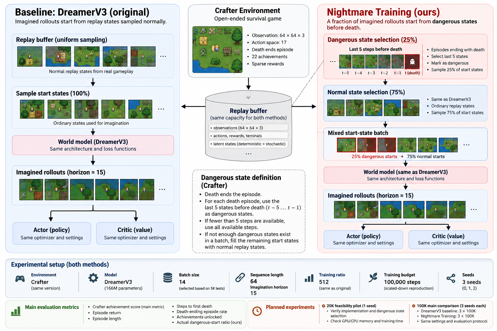

# Nightmare_Reinforced_Training_Crafter

An experimental extension of DreamerV3 for the Crafter survival environment.

## Project contribution

DreamerV3 learns a world model and improves its policy by imagining future
trajectories. In the standard method, imagination starts from ordinary states
sampled from the replay buffer.

This project proposes **Nightmare Training**, a targeted change to that
starting-state distribution:

> A fixed fraction of imagined rollouts starts from states shortly before
> death or episode termination.

The goal is to make the agent repeatedly imagine the situations in which it
is most likely to fail. We test whether this improves survival and sample
efficiency in Crafter without changing the model architecture, optimizer,
replay capacity, real-environment budget, or imagination budget.

This is a method-enhancement project, not a new DreamerV3 implementation.
The contribution is the selection of imagination start states.



## Research question

Can targeted imagination from dangerous states help DreamerV3 achieve a
higher Crafter score and survive longer with the same number of real
environment steps?

The main evaluation compares:

1. the official DreamerV3 baseline;
2. DreamerV3 with Nightmare Training.

Both methods must use the same Crafter configuration, batch size, replay
capacity, optimizer, number of updates, and random seeds.

## Evaluation plan

### 20K feasibility pilot

The 20K run is a technical pilot, not the final performance claim. It checks:

- whether dangerous replay states are selected correctly;
- whether baseline and extension produce valid training logs;
- GPU VRAM and system RAM usage;
- replay growth and checkpoint behavior;
- whether the planned 100K run is feasible.

### 100K main comparison

The planned main experiment uses Crafter for 100,000 environment steps. The
baseline and extension should be run with the same three seeds where compute
allows:

```text
DreamerV3 baseline:    100K steps x 3 seeds
Nightmare Training:    100K steps x 3 seeds
```

The primary metric is episode score. Secondary survival metrics are:

- episode length;
- steps until first death;
- death-ending episode rate;
- deaths per episode;
- episode termination prediction accuracy.

The 20K pilot does not replace the 100K comparison.

## Preliminary resource measurements

The measurements below come from clean 5K Crafter runs on a local NVIDIA RTX
5070 Ti. The GPU reported 16,303 MiB of total memory. WSL2 reported
approximately 15.45 GiB of system memory. JAX GPU preallocation was disabled.

| Batch | 5K time | Peak GPU | Estimated 100K time |
|---:|---:|---:|---:|
| 12 | 29.17 min | 10.05 GiB | 9 h 43 min |
| **14** | **25.91 min** | **10.97 GiB** | **8 h 38 min** |
| 16 | 30.55 min | 15.58 GiB | 10 h 11 min |

Batch 14 is the current pilot-based choice: it was faster than batch 12 and
left substantially more GPU headroom than batch 16. These are short-pilot
measurements, not final training results.

Replay memory is independent of batch size. The measured raw replay cost is
**53,279 bytes per transition**, including images, latent states, and metadata.
Replay capacity must therefore be identical between the baseline and the
extension and must be reported explicitly.

## Reproducing the setup

The Crafter-specific setup is designed for WSL2 Ubuntu:

```powershell
wsl -d Ubuntu
```

```bash
cd /mnt/c/Users/atak6/Downloads/Dream
source setup/activate.sh
python setup/check_environment.py
```

The environment check verifies dependencies, JAX GPU initialization, and the
Crafter adapter. It does not train the agent.

The profiling scripts in [`setup/`](setup/) record GPU, RAM, swap, disk and
training telemetry. Raw checkpoints, videos, profiler traces, and large
telemetry files are intentionally excluded from Git.

## Project files

- [`setup/README.md`](setup/README.md): WSL2 installation and environment notes
- [`setup/profile_memory.py`](setup/profile_memory.py): bounded Crafter memory
  and speed profiling
- [`setup/compare_batches.py`](setup/compare_batches.py): batch comparison
- [`logs/batch_comparison/PROJECT_SUMMARY_TR.md`](logs/batch_comparison/PROJECT_SUMMARY_TR.md):
  detailed project contribution and experiment summary
- [`logs/batch_comparison/REPORT_TR.md`](logs/batch_comparison/REPORT_TR.md):
  batch comparison report

## Current status

Completed:

- Crafter installation and environment verification;
- real DreamerV3 GPU training;
- loss and parameter updates;
- clean 5K batch 12, 14 and 16 resource pilots;
- replay memory measurement.

Not completed yet:

- Nightmare Training implementation;
- 100K baseline runs;
- 100K baseline-versus-extension comparison;
- three-seed evaluation;
- final Crafter score comparison with the published DreamerV3 result.

The current measurements validate the setup and resource plan. They do not
yet establish a performance improvement.

## Reference

This project is based on the open-source DreamerV3 implementation:

```bibtex
@article{hafner2025dreamerv3,
  title={Mastering diverse control tasks through world models},
  author={Hafner, Danijar and Pasukonis, Jurgis and Ba, Jimmy and Lillicrap, Timothy},
  journal={Nature},
  year={2025}
}
```

- Official implementation: https://github.com/danijar/dreamerv3
- Paper: https://arxiv.org/abs/2301.04104
